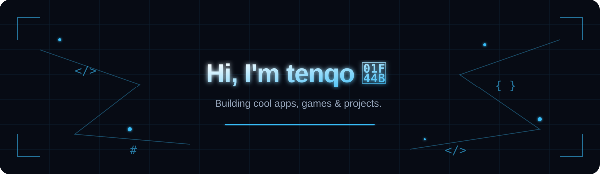

 

### 👋 Welcome to my GitHub profile!

I'm **tenqo** — building cool apps, games, and random projects.

---

## 🚀 Featured Projects

<table>
<tr>
<td width="50%" align="center">

### 🧮 NumCals

A modern calculator application.

</td>

<td width="50%" align="center">

### 🚧 More Coming Soon

More projects are currently being built.

✨ Stay tuned!

</td>
</tr>
</table>

---

## 📊 GitHub Stats

---

## 🎮 Contribution Game

<picture>
  <source media="(prefers-color-scheme: dark)" srcset="https://raw.githubusercontent.com/tenqo/tenqo/output/github-contribution-grid-snake-dark.svg">
  <source media="(prefers-color-scheme: light)" srcset="https://raw.githubusercontent.com/tenqo/tenqo/output/github-contribution-grid-snake.svg">
  
</picture>

---

### ⭐ Thanks for visiting!

Check out my repositories and see what I'm building! 🚀

