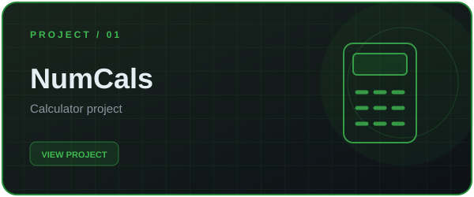
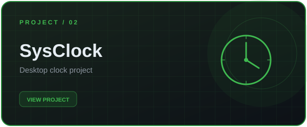
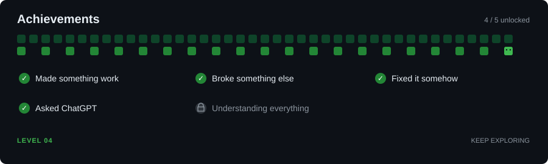

building cool apps, games and random projects.

    

<!-- PROJECTS -->

<table width="100%" align="center">
  <tr>
    <td width="50%" align="center">
      
    </td>
    <td width="50%" align="center">
      
    </td>
  </tr>
</table>

   

<!-- ACHIEVEMENTS -->

   

<!-- CONTRIBUTIONS -->

── snake arena ──

  

<picture>
  <source
    media="(prefers-color-scheme: dark)"
    srcset="https://raw.githubusercontent.com/tenqo/tenqo/output/github-contribution-grid-snake-dark.svg"
  />

  <source
    media="(prefers-color-scheme: light)"
    srcset="https://raw.githubusercontent.com/tenqo/tenqo/output/github-contribution-grid-snake.svg"
  />

  
</picture>

  

building • breaking • fixing • repeating

  

<a href="https://github.com/tenqo?tab=repositories">
  Browse all repositories →
</a>

