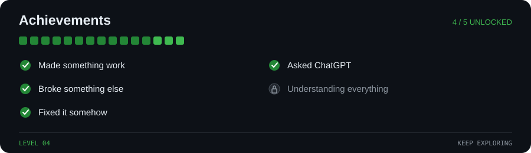

  

 

I create apps, Websites, Games and Extensions.

 

## Projects

<a href="https://github.com/tenqo/UClean">
  <picture>
    <source
      media="(prefers-color-scheme: light)"
      srcset="https://socialify.git.ci/Tenqo/UClean/image?custom_language=JavaScript&description=1&font=Inter&language=1&name=1&owner=1&pattern=Floating+Cogs&theme=Light"
    />
    <source
      media="(prefers-color-scheme: dark)"
      srcset="https://socialify.git.ci/Tenqo/UClean/image?custom_language=JavaScript&description=1&font=Inter&language=1&name=1&owner=1&pattern=Floating+Cogs&theme=Dark"
    />
    
  </picture>
</a>
<a href="https://github.com/tenqo/NumCals">
  <picture>
    <source
      media="(prefers-color-scheme: light)"
      srcset="https://socialify.git.ci/Tenqo/Numcals/image?description=1&language=1&name=1&owner=1&pattern=Floating+Cogs&theme=Light"
    />
    <source
      media="(prefers-color-scheme: dark)"
      srcset="https://socialify.git.ci/Tenqo/Numcals/image?description=1&language=1&name=1&owner=1&pattern=Floating+Cogs&theme=Dark"
    />
    
  </picture>
</a>
<a href="https://github.com/tenqo/SysClock">
  <picture>
    <source
      media="(prefers-color-scheme: light)"
      srcset="https://socialify.git.ci/Tenqo/Sysclock/image?description=1&language=1&name=1&owner=1&pattern=Floating+Cogs&theme=Light"
    />
    <source
      media="(prefers-color-scheme: dark)"
      srcset="https://socialify.git.ci/Tenqo/Sysclock/image?description=1&language=1&name=1&owner=1&pattern=Floating+Cogs&theme=Dark"
    />
    
  </picture>
</a>

   

## Achievements

<picture>
  <source
    media="(prefers-color-scheme: dark)"
    srcset="https://raw.githubusercontent.com/tenqo/tenqo/main/achievements-dark.svg"
  />
  <source
    media="(prefers-color-scheme: light)"
    srcset="https://raw.githubusercontent.com/tenqo/tenqo/main/achievements-light.svg"
  />
  
</picture>

   

## Contributions

── snake arena ──

  

<picture>
  <source
    media="(prefers-color-scheme: dark)"
    srcset="https://raw.githubusercontent.com/tenqo/tenqo/output/github-contribution-grid-snake-dark.svg"
  />
  <source
    media="(prefers-color-scheme: light)"
    srcset="https://raw.githubusercontent.com/tenqo/tenqo/output/github-contribution-grid-snake.svg"
  />
  
</picture>

  

building • breaking • fixing • repeating

  

<a href="https://github.com/tenqo?tab=repositories">
  Browse all repositories →
</a>

